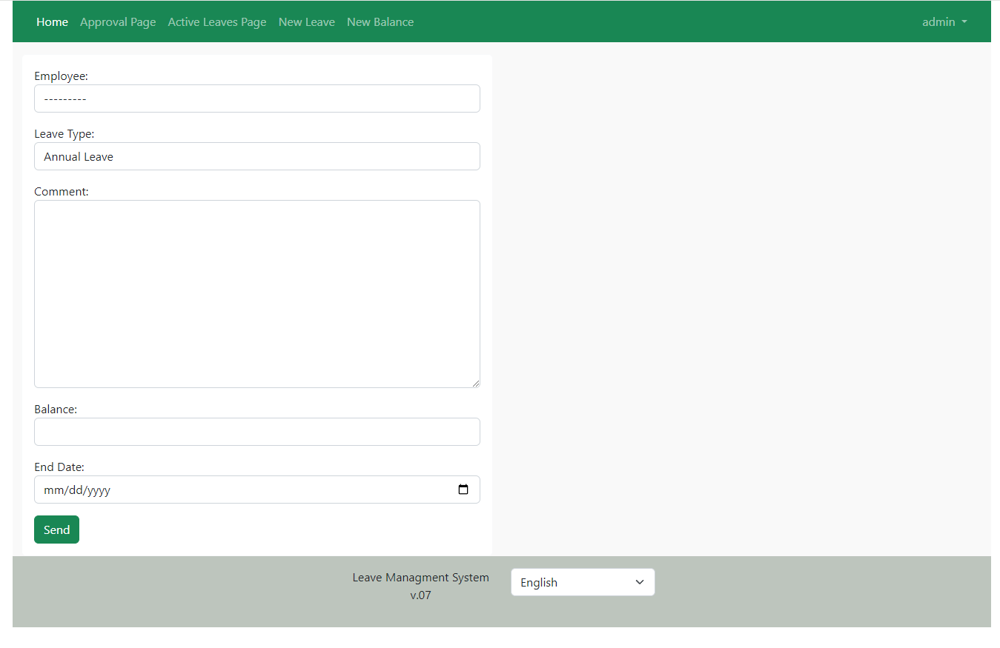
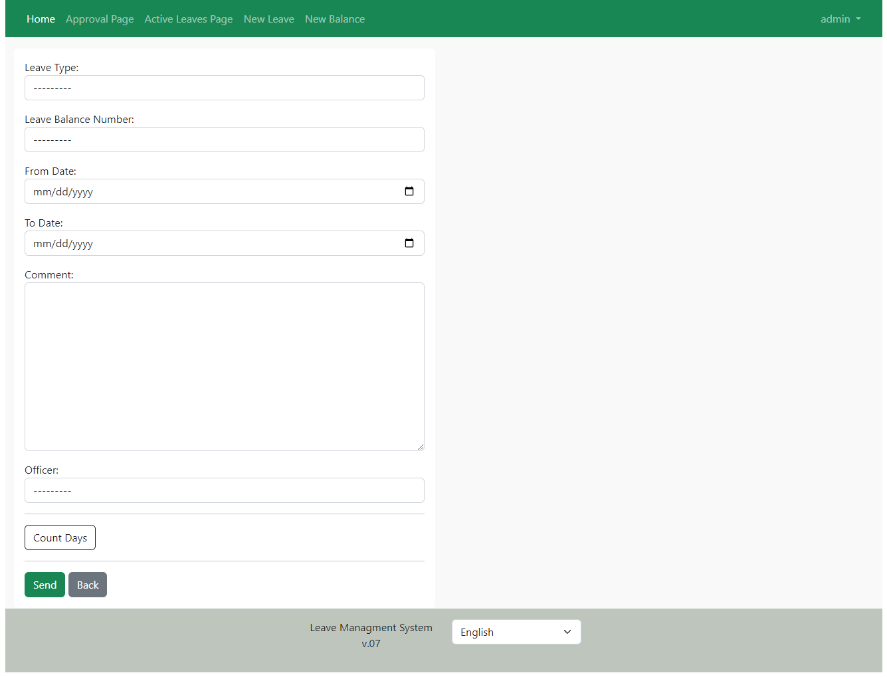
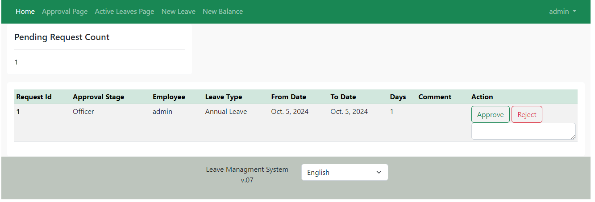
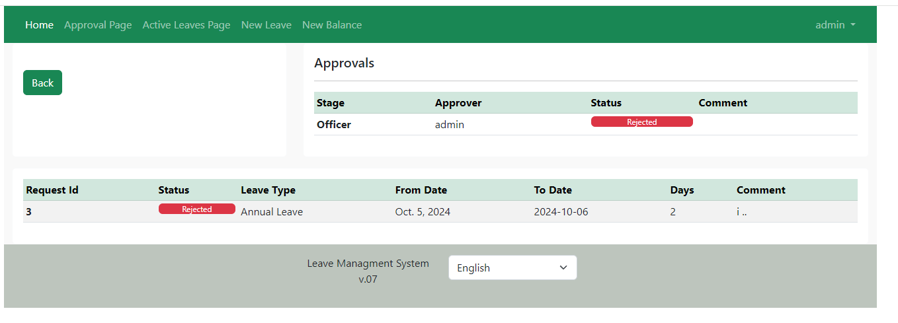

<p align="center">
  
</p>

# Django Leave Management System

A web-based employee Leave Management System built with Django and PostgreSQL, with Docker and Docker Compose used for containerized application setup.

## Overview

The **Leave Management System** provides a centralized platform for managing employee leave requests, tracking leave balances, and handling the approval workflow.

## Features

- **User Accounts**
  - Employee authentication and account management.
  - Users can view their leave balance and manage leave requests.

- **Leave Requests**
  - Submit leave requests for different leave types, including Annual Leave and Sick Leave.
  - Specify leave dates and track submitted requests.

- **Approval Workflow**
  - Leave requests can be reviewed and processed through an approval workflow.
  - Requests can have different statuses such as Pending, Approved, Rejected, Modified, and Canceled.

- **Leave Balance Tracking**
  - View available leave balances.
  - Track leave usage through the application dashboard.

- **Request Dashboard**
  - View request counts and previously submitted leave requests.
  - Monitor the status of individual requests.

- **Email Notifications**
  - Automated notifications can keep users informed about leave request status.

## Tech Stack

| Category | Technologies |
|---|---|
| Backend | Python, Django |
| Frontend | HTML, CSS, JavaScript |
| Database | PostgreSQL |
| Containerization | Docker, Docker Compose |
| Version Control | Git, GitHub |

## Project Structure

```text
Django-leave-management-system/
│
├── docs/                  # Project documentation
├── images/                # Application screenshots
├── src/                   # Django application source code
├── Dockerfile             # Docker image configuration
├── docker-compose.yaml    # Docker Compose configuration
├── requirements.txt       # Python dependencies
├── .gitignore
├── LICENSE
└── README.md


## Usage
[Setup the application](./docs/Setup.md)


## Note
Check [docs](./docs/) for more info.
Use [Obisden md](https://obsidian.md/) for a better reading experience.

## Pics
<p align="center">


</p>
<p align="center">


</p>
