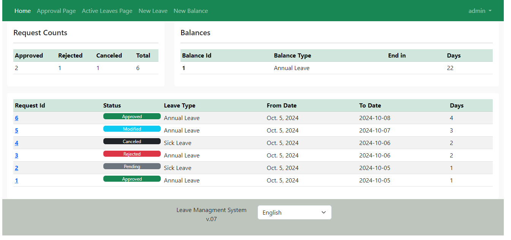

<p align="center">
  
</p>


## Overview

The **Leave Management System** is a Django-based web application designed to simplify and streamline employee leave management. It provides users with a centralized platform to submit leave requests, track leave balances, and manage the approval process.


## Features

- **User Accounts**:
    Employees can securely log in to their accounts, view their leave balance, and manage their leave requests.

- **Leave Requests**:
    Employees can submit requests for different types of leave, including Annual Leave and Sick Leave, by specifying the required dates and details.

- **Approval Workflow**:
    Submitted leave requests can be reviewed and processed through an approval workflow with different request statuses.

- **Leave Balance Tracking**:
    The system maintains and displays employee leave balances, helping users monitor their available leave.

- **Request Status Management**:
    Users can view the status of their leave requests, including pending, approved, rejected, modified, and canceled requests.

- **Email Notifications**:
    Automated email notifications help keep users informed about updates to their leave requests.


## Tech Stack

- **Backend:** Python, Django
- **Frontend:** HTML, CSS, JavaScript
- **Database:** PostgreSQL
- **Containerization:** Docker, Docker Compose
- **Version Control:** Git, GitHub


## Project Structure

```text
Django-leave-management-system/
│
├── docs/                 # Documentation and setup guide
├── images/               # Application screenshots
├── src/                  # Django application source code
├── .gitignore            # Git ignored files
├── Dockerfile            # Docker image configuration
├── docker-compose.yaml   # Docker Compose configuration
├── LICENSE               # Project license
├── README.md             # Project documentation
└── requirements.txt      # Python dependencies
